# Les bases du traitement de photo astronomique (noir et blanc)

## Quelques photos finies

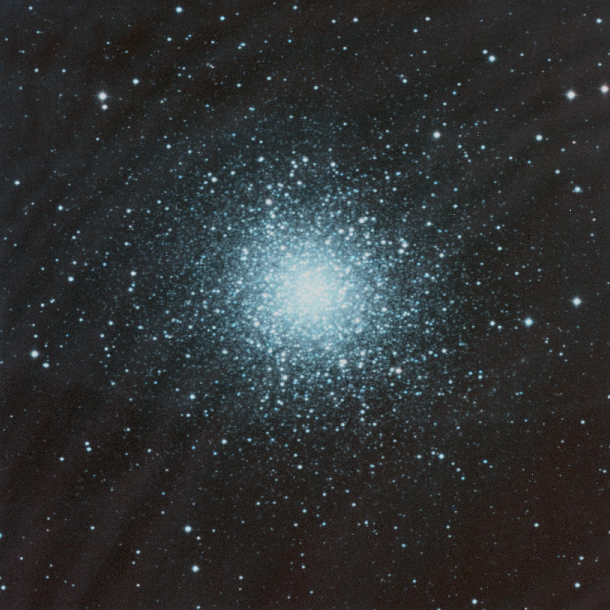
Amas stellaire M13
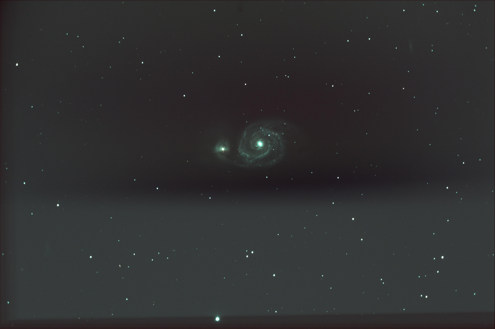
Galaxie M51
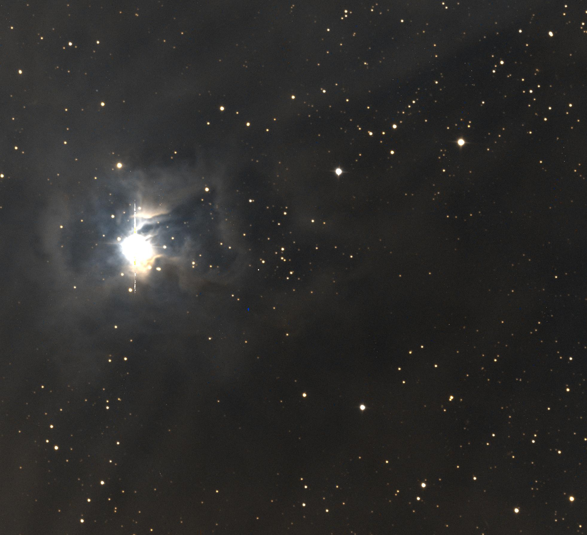
Nébuleuse NGC7023 (de l'iris)

# Site web
> PS : le contenu de ce readme correspond au fichier `site1.html`. Pour voir le site, il faut cloner/télecharger le git

Bienvenue ! Sur ce site, vous trouverez tout le nécessaire pour faire un traitement de photo astronomique de base à l'aide du logiciel Iris.

Le logiciel est entièrement en anglais et un peu brouillon au premier abord, mais pas de panique : une fois bien pris en main, ce logiciel est très agréable à utiliser. Je vous invite donc à suivre ce petit tutoriel et à naviguer à l'aide du sommaire ci-dessous.

Si vous souhaitez faire un traitement en couleur, je vous invite à visiter la page dédiée en cliquant [ici](site2.html).

## Sommaire

- [Installation de Iris](#installation-de-iris)
- [Configuration de Iris](#configuration-de-iris)
- [Première compilation de photos](#première-compilation-de-photos)

---

## Installation de Iris

Pour installer le logiciel Iris, il faut se rendre sur son site et télécharger le fichier ZIP ([cliquez ici pour le télécharger](http://www.astrosurf.com/buil/iris-software.html)).

Une fois téléchargé, il faut le décompresser dans le dossier où vous souhaitez que votre logiciel soit installé.

Si tout se passe bien, vous devriez avoir une interface comme celle-ci :

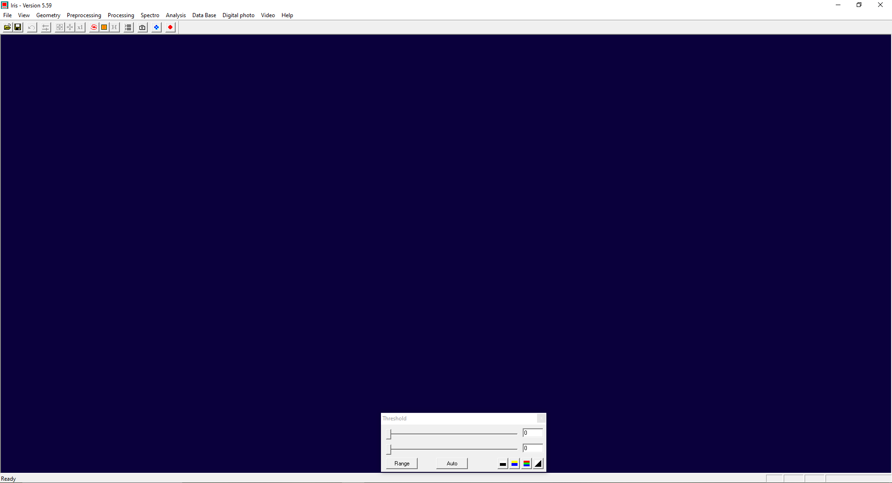

---

## Configuration de Iris

Avant de commencer la configuration, je tiens à préciser que ce tutoriel vous permettra de faire une configuration « de base ». Beaucoup de paramètres seront donc laissés par défaut.

De plus, ce tutoriel part du principe que vos photos sont au format *CR2*. Vérifiez bien si c'est votre cas avant de vous lancer.

Pour prendre des photos dans ce format, je vous invite à consulter la notice de votre appareil photo ou à regarder un tutoriel sur Internet.

### Définir l'espace de travail

Dans un premier temps, nous allons configurer les paramètres qui permettront de définir l'espace de travail.

Pour cela, il faut se rendre dans les menus déroulants en haut, puis aller dans *File* et sélectionner *Settings*.

Le premier paramètre à changer sera *Working path*. Ce paramètre est très important, car c'est ici que vous allez définir où vos images seront enregistrées.

Pour le choisir, il suffit de sélectionner les points de suspension.

Deuxième paramètre très important : *File type*. C'est l'extension que vos photos doivent avoir.

Dans mon cas, je le mets en *PIC*, mais cela dépend de l'extension de vos photos.

Pour connaître l'extension de vos photos, il faut faire un clic droit sur la photo et sélectionner *Propriétés*. Le type d'extension sera indiqué à côté de *Type du fichier*.

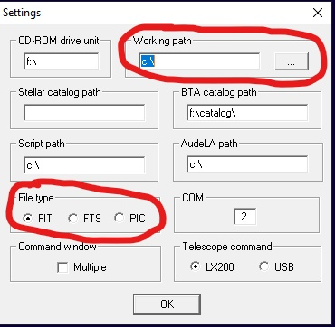

### Configurer les paramètres de l'appareil photo

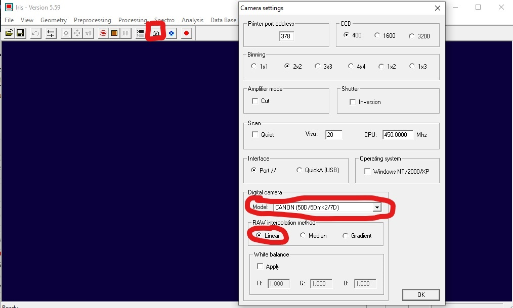

Une fois cela fait, nous allons effectuer un réglage en fonction de l'appareil photo.

Avant de commencer, il faudra donc vous munir de la référence de votre appareil photo.

Pour commencer, il faut cliquer sur le petit appareil photo dans la barre des menus rapides. Une nouvelle fenêtre devrait alors apparaître.

Ici, nous réglerons le paramètre *Model*. Dans le menu déroulant, il vous suffit de choisir le modèle de votre appareil photo.

Si votre modèle n'est pas dans la liste, il faudra se rendre sur la page Web du fabricant pour trouver la balance RGB.

Vous pourrez alors renseigner ces valeurs dans la section *White balance*, en activant *Apply* et en entrant vos valeurs.

Dans notre cas, nous changerons aussi le paramètre *RAW interpolation method* en le passant sur *Linear*.

---

## Première compilation de photos

Maintenant que tout est enfin prêt, commençons le travail !

Avant de se lancer dans la compilation, il faut comprendre un phénomène très simple.

Quand on prend des photos à l'aide d'un télescope, très souvent, les astres ne sont pas à la même place d'une photo à l'autre, malgré le fait que vous puissiez avoir un moteur intégré au télescope pour limiter ce phénomène.

Cela signifie que si l'on veut compiler les photos, il est fort probable que les astres se démultiplient.

C'est pourquoi nous devrons faire en sorte que les astres soient au même emplacement sur la série de photos. Nous allons donc effectuer un alignement des étoiles.

Bon, fini les explications, place à la pratique !

### 1. Convertir les photos au format PIC

Pour commencer, il va falloir convertir vos photos au format *PIC*. Heureusement, Iris propose de le faire facilement.

Pour cela, il faudra aller dans le menu *Digital photo*, puis dans *Decode RAW files...*.

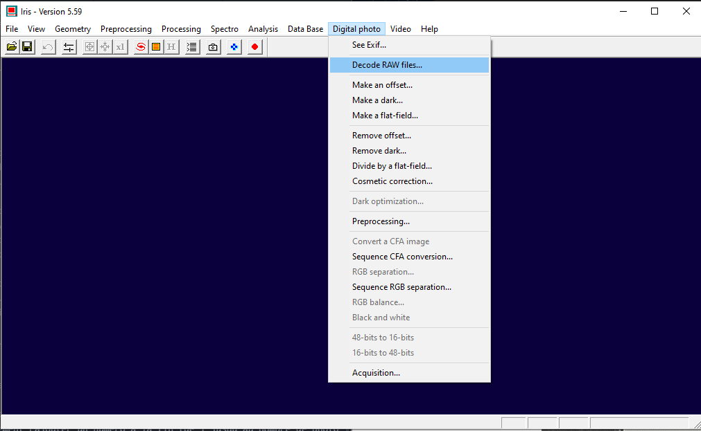

### 2. Choisir les photos à convertir

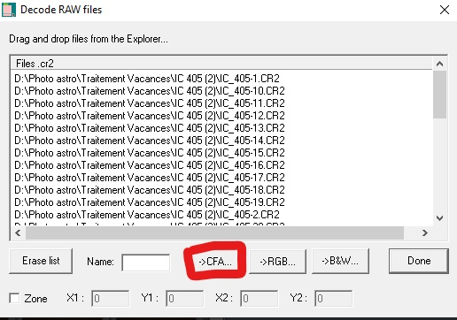

Il vous faudra alors faire un glisser-déposer dans la fenêtre principale, sous *Files .cr2*.

Si cela se passe bien, vous devriez voir apparaître le chemin de vos photos.

Dans mon cas, il s'agit de :

`D:\Photo astro\Traitement Vacances\IC 405 (2)`

Il reste donc à mettre un nom dans *Name*.

Je vous conseille vivement de choisir des noms explicites. Cela évitera de vous mélanger les pinceaux à la fin, car vous verrez qu'il y aura beaucoup de fichiers.

Dans mon cas, je traite des photos de l'amas IC-405. Je vais donc les nommer *IC_405-*.

Je finis toujours par un tiret (`-`), car Iris va automatiquement ajouter un numéro à la fin, de 1 jusqu'au nombre de photos entrées.

Ensuite, cliquez sur *->CFA* pour convertir vos photos au format *PIC*.

### 3. Aligner les étoiles

Si vous vous souvenez bien, nous allons maintenant effectuer l'alignement des étoiles.

Dans le menu, cliquez sur *Processing*, puis sur *Stellar registration...*.

Une nouvelle fenêtre apparaît.

Il faudra tout d'abord renseigner *Input generic name*, qui est le nom que vous avez attribué à l'étape précédente.

Le champ *Output generic name* correspond au nom qui sera donné aux photos une fois l'alignement effectué.

Personnellement, je les nomme comme précédemment, mais avec un `r` à la fin. Je choisis donc `IC_405r-`.

Il faut aussi renseigner le nombre de photos dans *Number*.

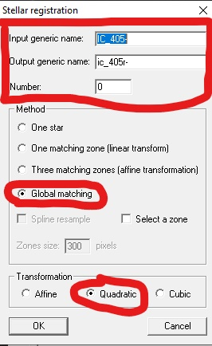

Pour les autres paramètres, je vais vous demander de me faire confiance. Si vous souhaitez davantage de détails, je vous invite à faire vos propres recherches sur Internet.

Pour notre traitement, nous utiliserons les options *Global matching* et *Quadratic*.

En fonction de la puissance de votre ordinateur et du nombre de photos, l'opération sera plus ou moins longue. Cela peut devenir très long si vous avez beaucoup de photos !

### 4. Compiler les photos

Allez, courage ! C'est la dernière étape avant d'obtenir votre image.

Si vous avez bien suivi les étapes précédentes, nous allons maintenant effectuer la compilation.

Pour cela, rendez-vous dans *Processing*, puis sélectionnez *Add a sequence...*.

Une nouvelle fenêtre va s'ouvrir. Nous aurons deux champs à compléter.

Le premier est *Input generic name*, qui correspond au nom des photos alignées.

J'insiste bien sur le fait qu'il s'agit du nom des photos qui ont subi l'étape précédente !

Encore une fois, il faudra entrer le nombre de photos dans *Number*.

Enfin, pensez à vérifier que l'option *Arithmetic* est cochée.

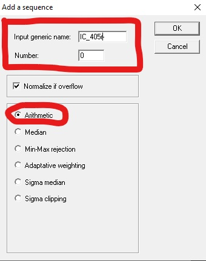

### 5. Afficher et sauvegarder l'image finale

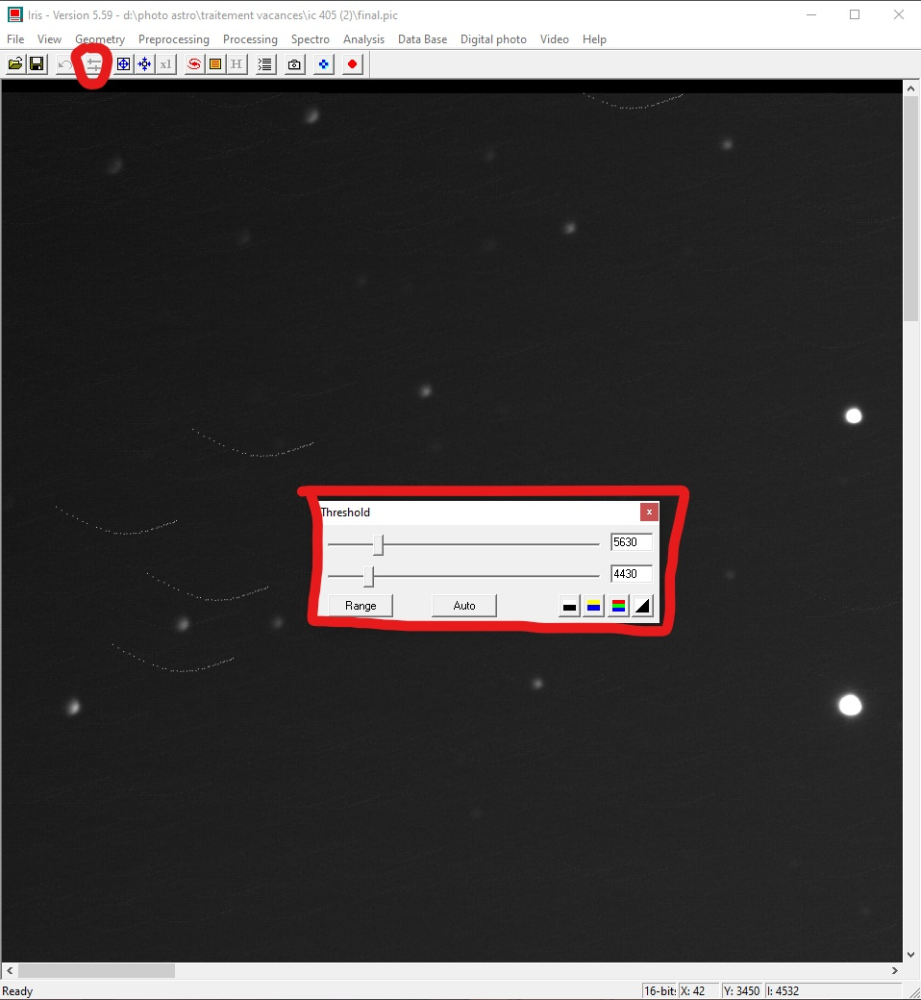

Si vous ne voyez pas grand-chose, pas de panique : c'est normal.

Appuyez sur le bouton avec les deux petites barres dans le menu. Une petite fenêtre nommée *Threshold* apparaît.

Cliquez sur *Auto*.

Pour voir l'intégralité de votre image, zoomez ou dézoomez à l'aide des deux logos bleus dans le menu.

Bravo, vous avez terminé votre premier traitement de photo !

N'oubliez surtout pas de sauvegarder votre image.

---

## Résultat final

Voilà ce que cela a donné de mon côté :

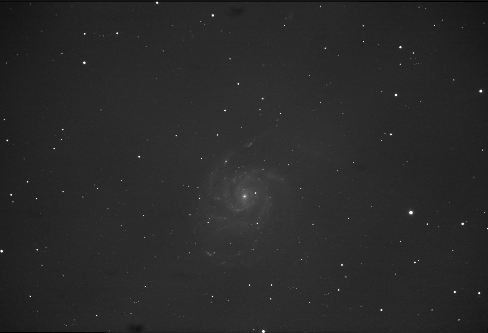